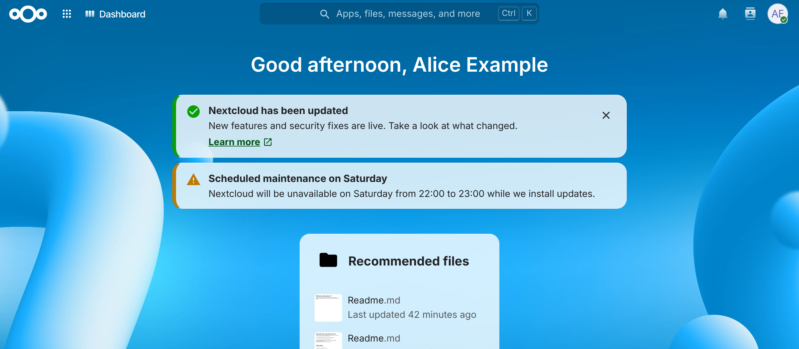
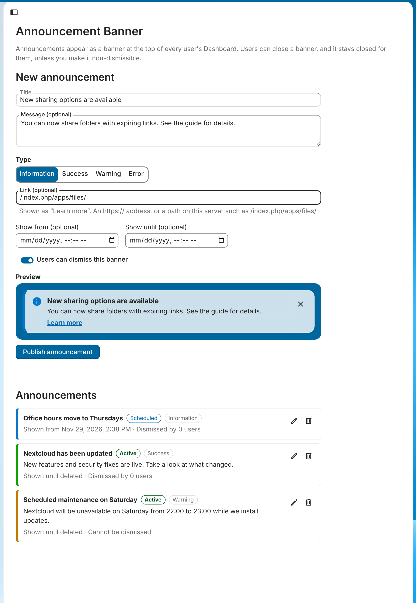

<!--
  - SPDX-FileCopyrightText: 2026 Nextcloud GmbH and Nextcloud contributors
  - SPDX-License-Identifier: AGPL-3.0-or-later
-->

# Announcement Banner

A Nextcloud app (Nextcloud **34 and 35**) that shows admin announcements as a banner on
the Dashboard, Nextcloud's home page: tell users about updates, maintenance windows and
other news where they will actually see it.



- **Write announcements** under *Administration settings > Announcement Banner*: a title,
  an optional message, a type (information, success, warning, error) and an optional
  "Learn more" link. A live preview shows exactly what users will see.
- **Schedule them**: show a banner from a start date, hide it after an end date.
- **Users close a banner once** and it stays closed for them. Announcements that must stay
  visible (an upcoming maintenance window) can be made non-dismissible.
- **Delegate it**: give a group (a communications team, say) the management page under
  *Administration settings > Administration privileges* without making them admins.
- **Automate it** from update scripts with `occ announcement_banner:create`.



## Install

From a release tarball (`announcement_banner-<version>.tar.gz`):

```bash
tar -xzf announcement_banner-1.0.0.tar.gz -C /var/www/nextcloud/custom_apps
sudo -u www-data php occ app:enable announcement_banner
```

From a git checkout the frontend has to be built first (the built `js/` and `css/` are not
in git):

```bash
git clone https://github.com/BurgiSimon/nextcloud-announcement-banner.git custom_apps/announcement_banner
cd custom_apps/announcement_banner
npm ci && npm run build
sudo -u www-data php ../../occ app:enable announcement_banner
```

The directory must be named `announcement_banner`, the app id.

## Use it from the command line

```bash
# publish; dates are UTC unless they name a zone, relative dates work too
occ announcement_banner:create "Nextcloud was updated" --level=success \
    --message="New features are live." --link="https://nextcloud.com/changelog/" --ends="+7 days"
occ announcement_banner:create "Maintenance on Saturday" --level=warning \
    --starts="2026-12-05 08:00 Europe/Zurich" --ends="2026-12-06 23:00 Europe/Zurich" --not-dismissible

occ announcement_banner:list              # or --output=json
occ announcement_banner:delete <id>
```

## How it works

| Piece | Where |
|---|---|
| Banner on the Dashboard | `lib/Listener/DashboardBannerListener.php` listens to `BeforeTemplateRenderedEvent`, acts only on the Dashboard page, and passes the user's active announcements as initial state. When there is nothing to show, no script is loaded. `src/banner.js` inserts the banner between the greeting and the widgets. |
| Data | `announcement_banner_ann` (announcements) and `announcement_banner_dis` (who dismissed what, unique per user and announcement), created by `lib/Migration/`. A deleted account's dismissals are removed (`UserDeletedListener`). |
| Rules | `lib/Service/AnnouncementService.php`: validation (links must be `http(s)://` or a path on this server, so never `javascript:`), schedule, dismissal. |
| API | `GET/POST /api/announcements`, `PUT/DELETE /api/announcements/{id}`: admins and delegated groups only. `GET /api/banner`, `POST /api/banner/{id}/dismiss`: every logged-in user. |
| Admin UI | `src/AdminSettings.vue` (Vue 3, `@nextcloud/vue`); the preview uses the same DOM code as the Dashboard (`src/bannerDom.js`). |

All user-provided text is rendered with `textContent`, never as HTML.

## Development

```bash
npm ci
npm run build             # or: npm run watch
composer install          # PHPUnit, Psalm, php-cs-fixer, nextcloud/ocp (stable34)
```

Tests and checks:

```bash
# unit tests, run anywhere
composer test:unit
# unit + integration (real database): run inside a Nextcloud install, or point at one
NEXTCLOUD_ROOT=/var/www/nextcloud vendor/bin/phpunit -c tests/phpunit.xml
# static analysis (needs PHP >= 8.3.16 or 8.4.3) and code style
composer psalm
composer cs:check
# browser tests against a running instance with the app enabled; needs an admin and a
# regular user account
NEXTCLOUD_ADMIN=admin NEXTCLOUD_ADMIN_PASSWORD=... NEXTCLOUD_USER=alice NEXTCLOUD_PASSWORD=... \
    PLAYWRIGHT_BASE_URL=https://cloud.example.com npx playwright test
```

`npx playwright install chromium` once, or set `PLAYWRIGHT_CHROMIUM_PATH` to a Chromium
you already have.

## Release

```bash
make appstore     # schema-checks appinfo/info.xml, builds, writes build/artifacts/announcement_banner-<version>.tar.gz
make package      # the same tarball without the schema check, for test installs
```

Bump `<version>` in `appinfo/info.xml` (and `package.json`) for every release; that is
what makes existing installations run new migrations on upgrade.

## License

AGPL-3.0-or-later, see [LICENSES/AGPL-3.0-or-later.txt](LICENSES/AGPL-3.0-or-later.txt).
